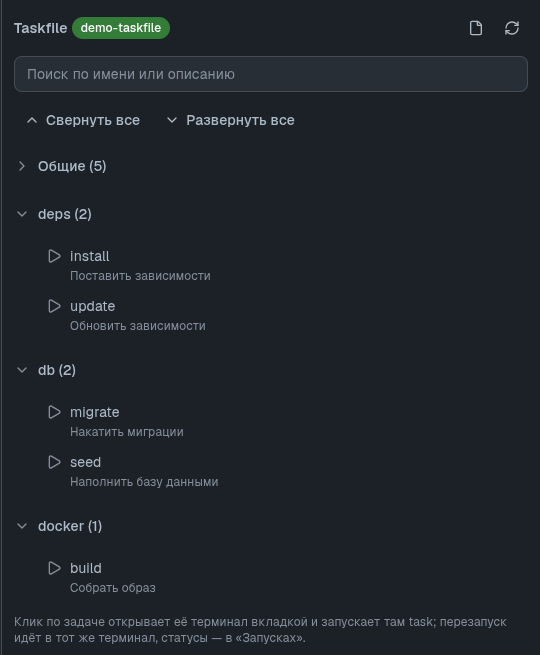
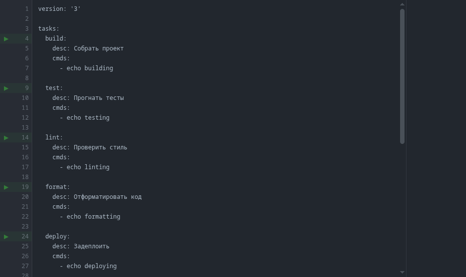

# Taskfile Runner

Плагин для [Orca](https://github.com/stablyai/orca): список задач из `Taskfile.yml` и запуск
их в терминале воркспейса.



## Что умеет

- Панель в правом баре показывает задачи `Taskfile.yml` фокусного воркспейса — с описаниями
  и фильтром по имени.
- Задачи с префиксом `:` собираются в группы: `deploy:api` попадёт в группу `deploy`.
- Клик по задаче открывает терминал воркспейса и запускает `task <имя>`. Без агента,
  без токенов — обычный `go-task` в обычном терминале.
- В панели видно статус запуска, задачу можно остановить, перезапустить или закрыть вместе с её
  терминалом — тогда карточка запуска пропадает из «Запусков» (и наоборот: если терминал закрыли
  вручную, карточка тоже исчезает).
- Для `Taskfile.yml` есть свой вид в редакторе: ▶ слева от строки запускает задачу.



## Установка

```sh
orca plugin install dimti/orca-plugin-taskfile
```

Плагин выполняет свой код, поэтому Orca спросит разрешения: покажет, что именно плагин
хочет, и даст готовую команду с `--approve`.

## Требования

- Orca `>=1.4.248`
- [go-task](https://taskfile.dev) в `PATH` — как `task` или как `go-task`

## Разработка

```sh
orca plugin validate .   # проверить манифест
orca plugin test .       # тесты плагина
orca plugin check .      # отрисовать панель по сценариям
orca plugin dev watch .  # загрузить папку в Orca и смотреть логи
```

## Известная грабля

Orca 1.4.255 считает content hash плагина вместе с папкой `.orca`, а одобрение — без неё.
Пока `.orca/` лежит в папке плагина, воркер не стартует (`content hash mismatch`).

Типы нужны только для подсказок в редакторе и генерируются по требованию:

```sh
orca plugin types .   # создаст .orca/
rm -rf .orca          # ...и его надо удалить, пока плагин не стартует
```

## Лицензия

MIT
